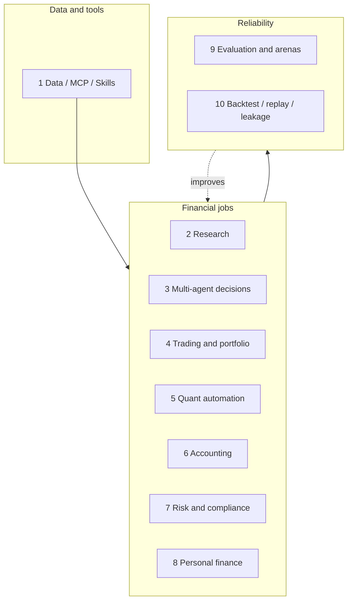

# Awesome Finance Agents 

> Open-source LLM agents for finance, organized by job: research, trading, operations, risk & compliance, personal finance, evaluation, and backtesting.

**English** | [简体中文](README.zh-CN.md)

> **Not investment advice.** Inclusion does not mean endorsement. Many projects are research demos; paper trading and live trading are different. You are responsible for compliance, risk, and losses.

This list is organized by **financial function**. Trading is one chapter; for a deeper trading-only catalog, see LLMQuant/awesome-trading-agents in the Appendix. It also covers accounting, compliance, evaluation, and backtesting/replay.

Each chapter answers: what problem it solves, which open-source projects to study, and one pitfall tip. Star counts are omitted so they do not go stale. 🇨🇳 marks China A-share / Chinese-language projects. `(sim)` / `(live)` / `(paper)` mark paper trading, live trading, or paper-code when known.

## Contents

- [The Map](#the-map)
- [How to Use This List](#how-to-use-this-list)
- [1. Data and Tools](#1-data-and-tools)
- [2. Investment Research and Deep Research](#2-investment-research-and-deep-research)
- [3. Multi-Agent Research and Decision Systems](#3-multi-agent-research-and-decision-systems)
- [4. Trading Execution and Portfolio Management](#4-trading-execution-and-portfolio-management)
- [5. Quantitative Research Automation](#5-quantitative-research-automation)
- [6. Finance Operations and Accounting](#6-finance-operations-and-accounting)
- [7. Risk, Compliance, and Audit](#7-risk-compliance-and-audit)
- [8. Personal Finance](#8-personal-finance)
- [9. Evaluation Benchmarks and Arenas](#9-evaluation-benchmarks-and-arenas)
- [10. Backtesting, Replay, and Leakage Control](#10-backtesting-replay-and-leakage-control)
- [Appendix](#appendix)
  - [Financial LLMs and related models](#financial-llms-and-related-models)
  - [Surveys and paper lists](#surveys-and-paper-lists)
  - [Related awesome lists](#related-awesome-lists)

## The Map

| #  | Chapter               | Core question                                                              |
| -- | --------------------- | -------------------------------------------------------------------------- |
| 1  | Data and Tools        | How does the agent get trustworthy, timestamped market and filing data?    |
| 2  | Investment Research   | How does it turn filings and news into source-backed memos?                |
| 3  | Multi-Agent Decisions | How do specialized agents debate and hand off a decision?                  |
| 4  | Trading and Portfolio | How does a signal become a sized, risk-checked order?                      |
| 5  | Quant Automation      | How do agents mine factors and iterate strategies?                         |
| 6  | Accounting            | How do agents bookkeep, reconcile, and report without rewriting history?   |
| 7  | Risk and Compliance   | How are AML/KYC, DD, and irreversible actions gated?                       |
| 8  | Personal Finance      | How do local-first apps expose budgets and accounts to agents?             |
| 9  | Evaluation and Arenas | How do we measure research, decisions, safety, and live skill?             |
| 10 | Backtest and Leakage  | How do we keep market-time correctness under agent loops?                  |

## How to Use This List

**Building a research agent.** Start with chapters 1 → 2 → 9.

**Building a trading agent.** Read 1 → 3/4 → 10 → 9, then use the trading-only list linked in the Appendix for more depth.

**Ops / compliance / personal finance.** Start with chapters 6, 7, and 8.

**Interview or design review.** Use each chapter's pitfall tip as a failure-mode checklist.

This is a shortlist, not a catalog. Links were checked when added; CI runs awesome-lint and a weekly link checker.

## 1. Data and Tools

### What Problem It Solves

A finance agent is only as good as the data and tools it can call. This chapter covers market data, filings, broker bridges, and skill packs that expose those capabilities to MCP-aware agents.

### Platforms and market data

- [OpenBB](https://github.com/openbq-org/OpenBB) - Open data platform for analysts, quants, and AI agents across equities, options, crypto, and macro.
- [akshare](https://github.com/akfamily/akshare) - 🇨🇳 China A-share and multi-market data toolkit widely used as an agent data backend.
- [a-stock-data](https://github.com/simonlin1212/a-stock-data) - 🇨🇳 High-coverage A-share data endpoints designed for agent and research workflows.
- [edgartools](https://github.com/dgunning/edgartools) - Typed Python API for SEC EDGAR: 10-K/8-K, XBRL, 13F, Form 3/4/5.
- [MarS](https://github.com/microsoft/MarS) - Microsoft financial market simulation engine powered by a generative foundation model.

### MCP servers

- [financial-services](https://github.com/anthropics/financial-services) - Anthropic official skills and connectors pack for financial-services workflows.
- [alpaca-mcp-server](https://github.com/alpacahq/alpaca-mcp-server) - Official Alpaca MCP for stocks, ETFs, options, and crypto with paper trading. (sim)
- [FinanceMCP](https://github.com/guangxiangdebizi/FinanceMCP) - 🇨🇳 Tushare + Binance finance MCP for Claude-style agents.
- [mcp-cn-a-stock](https://github.com/elsejj/mcp-cn-a-stock) - 🇨🇳 MCP server that exposes China A-share market data to LLMs.
- [sec-edgar-mcp](https://github.com/stefanoamorelli/sec-edgar-mcp) - MCP server for browsing and querying SEC EDGAR filings.
- [yahoo-finance-mcp](https://github.com/Alex2Yang97/yahoo-finance-mcp) - Yahoo Finance market data exposed over MCP.
- [mcp_massive](https://github.com/massive-com/mcp_massive) - MCP for Massive.com (formerly Polygon) market data.
- [tradingview-mcp](https://github.com/atilaahmettaner/tradingview-mcp) - TradingView MCP: market data, screeners, technicals, and backtesting bridges.
- [polymarket-mcp-server](https://github.com/caiovicentino/polymarket-mcp-server) - MCP for Polymarket prediction markets with monitoring and safety features. (sim/live)
- [okx/agent-trade-kit](https://github.com/okx/agent-trade-kit) - OKX trading MCP for spot, swap, futures, options, and grid bots. (live)

### Skills packs

- [finance-skills](https://github.com/himself65/finance-skills) - Skill pack for AI financial analysis workflows.
- [claude-trading-skills](https://github.com/tradermonty/claude-trading-skills) - Claude skills pack for US equity investors and traders.

### Pitfall Tip

Prefer point-in-time and timestamped sources. Do not let the model invent ticker prices or filing numbers. Mark any tool that can place an order as write-capable and gate it behind approval.

## 2. Investment Research and Deep Research

### What Problem It Solves

Research agents read filings, transcripts, news, and data rooms, then produce source-backed investment memos. The hard part is grounding every number and claim.

### Open-source research agents

- [dexter](https://github.com/virattt/dexter) - Autonomous deep financial research agent with tool use and structured reports.
- [FinRobot](https://github.com/AI4Finance-Foundation/FinRobot) - Open-source AI agent platform for financial applications from AI4Finance.
- [LangAlpha](https://github.com/ginlix-ai/LangAlpha) - Claude Code style workbench aimed at financial markets research.
- [FinSight](https://github.com/RUC-NLPIR/FinSight) - Deep financial research agent framework (ACL 2026 lineage).
- [ai-berkshire](https://github.com/xbtlin/ai-berkshire) - Value-investing multi-agent research in a Buffett/Munger style.
- [Vibe-Research](https://github.com/simonlin1212/Vibe-Research) - 🇨🇳 A/US/HK equity research workbench with a large local data surface.
- [ai-financial-agent](https://github.com/virattt/ai-financial-agent) - Investment research financial agent from the dexter/ai-hedge-fund author.
- [DeepEar](https://github.com/HKUSTDial/DeepEar) - 🇨🇳 Deep research and financial signal tracking framework (顺风耳).
- [claude-equity-research](https://github.com/quant-sentiment-ai/claude-equity-research) - Claude Code plugin for institutional-style equity research workflows.
- [easy-stock](https://github.com/jundizhou/easy-stock) - 🇨🇳 A-share analysis and AI research desktop workbench.
- [Seris](https://github.com/aowang-ai/seris) - Desktop AI market research assistant: chat beside live charts, price alerts, and local backtests with your own model.

### Pitfall Tip

Require citations to filing sections or URLs. Reject answers that invent financial ratios. Prefer agents that keep a tool-call trail you can audit.

## 3. Multi-Agent Research and Decision Systems

### What Problem It Solves

These systems simulate an analyst team: specialized agents debate, hand off, and reach a decision. Useful for exploring role structure, not as out-of-the-box alpha.

### Flagship multi-agent systems

- [TradingAgents](https://github.com/TauricResearch/TradingAgents) - Multi-agent LLM trading framework with analyst, trader, and risk roles.
- [ai-hedge-fund](https://github.com/virattt/ai-hedge-fund) - AI hedge fund simulation with specialized investing agents.
- [TradingAgents-CN](https://github.com/hsliuping/TradingAgents-CN) - 🇨🇳 Chinese-enhanced TradingAgents with local market adaptations.
- [valuecell](https://github.com/ValueCell-ai/valuecell) - Community multi-agent platform aimed at financial applications.
- [AutoHedge](https://github.com/The-Swarm-Corporation/AutoHedge) - Swarm-style auto-hedge multi-agent system.
- [TradingAgents-astock](https://github.com/simonlin1212/TradingAgents-astock) - 🇨🇳 A-share adapted TradingAgents with local data features.
- [aiagents-stock](https://github.com/oficcejo/aiagents-stock) - 🇨🇳 Multi-AI stock team for analysis, watchlists, and sector rotation alerts.
- [TradingAgents-AShare](https://github.com/KylinMountain/TradingAgents-AShare) - 🇨🇳 A-share multi-agent research desk with debate UI.
- [lumibot](https://github.com/Lumiwealth/lumibot) - Broker-connected trading agents with backtests across many brokers. (sim/live)
- [ai-hedge-fund-crypto](https://github.com/51bitquant/ai-hedge-fund-crypto) - Crypto-oriented fork of ai-hedge-fund.

### Pitfall Tip

Debate does not equal correctness. Watch for shared context contamination across agents and for consensus that is just the loudest prompt.

## 4. Trading Execution and Portfolio Management

### What Problem It Solves

From signal to order: position sizing, risk budgets, broker/exchange connectors, and portfolio analytics. For a broader trading-only catalog, see LLMQuant/awesome-trading-agents in the Appendix.

### LLM trading agents

- [daily_stock_analysis](https://github.com/ZhuLinsen/daily_stock_analysis) - 🇨🇳 LLM multi-market stock analysis with dashboard and alerts.
- [Vibe-Trading](https://github.com/HKUDS/Vibe-Trading) - Personal trading agent stack from HKUDS. (sim)
- [AI-Trader](https://github.com/HKUDS/AI-Trader) - Agent-native automated trading research system.
- [nofx](https://github.com/NoFxAiOS/nofx) - AI trading terminal assistant for US stocks, commodities, forex, and crypto. (sim/live)
- [OpenAlice](https://github.com/TraderAlice/OpenAlice) - One-person Wall Street style AI trading agent across assets.
- [AgenticTrading](https://github.com/Open-Finance-Lab/AgenticTrading) - Agentic trading research codebase paired with evaluation harnesses.
- [FinRL-Trading](https://github.com/AI4Finance-Foundation/FinRL-Trading) - AI-native modular infrastructure for quantitative trading (FinRL-X).
- [FinMem-LLM-StockTrading](https://github.com/pipiku915/FinMem-LLM-StockTrading) - Layered-memory LLM trading agent from the FinMem line of work. (paper)
- [jev-trade](https://github.com/aowang-ai/jev-trade) - Model-driven Hyperliquid trader: one call per tick across five isolated coin sleeves, with a live desk and dry-run mode. (sim/live)

### Broker bridges and execution substrates

- [alpaca-py](https://github.com/alpacahq/alpaca-py) - Official Alpaca Python SDK; common backend for paper/live agent trading. (sim/live)
- [freqtrade](https://github.com/freqtrade/freqtrade) - Popular crypto trading bot often used as an execution backend for agents. (sim/live)
- [hummingbot](https://github.com/hummingbot/hummingbot) - Open-source crypto market making and execution framework. (live)
- [tradememory-protocol](https://github.com/mnemox-ai/tradememory-protocol) - Decision audit trail and memory protocol for AI trading agents.

### Pitfall Tip

Separate paper from live. Never give an agent unbounded live order permission. Model fees, slippage, and halt rules before trusting PnL screenshots.

## 5. Quantitative Research Automation

### What Problem It Solves

Agents that mine factors, write strategy code, run backtests, and iterate. Closest thing to an autonomous quant researcher.

### Research automation systems

- [qlib](https://github.com/microsoft/qlib) - AI-oriented quant platform; common substrate for factor and model research agents.
- [RD-Agent](https://github.com/microsoft/RD-Agent) - Microsoft R&D agent with a strong finance factor/strategy automation track.
- [alphagen](https://github.com/ICT-FinD-Lab/alphagen) - RL-based generation of formulaic alpha factor sets.
- [QuantaAlpha](https://github.com/QuantaAlpha/QuantaAlpha) - Agentic workflow for discovering quantitative alpha factors.
- [QuantGPT](https://github.com/Miasyster/QuantGPT) - Agent-driven alpha factory that designs, backtests, and submits factors.
- [AlphaFin](https://github.com/AlphaFin-proj/AlphaFin) - Retrieval-augmented stock-chain style financial analysis.
- [pwb-alphaevolve](https://github.com/paperswithbacktest/pwb-alphaevolve) - AlphaEvolve-style coding agent applied to trading strategies.
- [Alpha-R1](https://github.com/FinStep-AI/Alpha-R1) - Alpha and factor research agent line from FinStep-AI.

### Pitfall Tip

Factor factories overfit fast. Demand walk-forward or purged CV, and keep a holdout the agent never sees.

## 6. Finance Operations and Accounting

### What Problem It Solves

Agents for bookkeeping, reconciliation, invoice review, and reporting.

### Ledgers and agent accountants

- [beancount](https://github.com/beancount/beancount) - Double-entry plaintext accounting ledger; common target for bookkeeping agents.
- [fava](https://github.com/beancount/fava) - Web UI for Beancount; useful review surface next to an accounting agent.
- [Klaudia](https://github.com/Yudhyy/Klaudia) - Self-hosted agentic accountant for receipts, reconciliation, and approvals.
- [norman-mcp-server](https://github.com/norman-finance/norman-mcp-server) - MCP for AI-powered bookkeeping and tax filing automation (EU-oriented).
- [Bookkeeping-Agency-Skill](https://github.com/cyhzzz/Bookkeeping-Agency-Skill) - 🇨🇳 Skills pack for China bookkeeping-agency vertical agents.

### Pitfall Tip

Accounting agents must be append-only or approval-gated. Never let an agent silently rewrite historical ledger entries.

## 7. Risk, Compliance, and Audit

### What Problem It Solves

AML/KYC, fraud triage, due diligence, ESG review, and action firewalls that sit in front of irreversible agent actions (orders, payments, ledger writes).

### Due diligence, AML/KYC, and firewalls

- [due-diligence-agents](https://github.com/zoharbabin/due-diligence-agents) - Multi-agent M&A / corporate due diligence workflows.
- [cordum](https://github.com/cordum-io/cordum) - Agent action firewall for approving high-risk tool calls before they execute.
- [tcaml-framework](https://github.com/tomcustos/tcaml-framework) - Open AML/KYC/KYB agent framework with explicit human gates.
- [MutiAgent4Fraud](https://github.com/zheng977/MutiAgent4Fraud) - Multi-agent fraud detection research system.
- [agentfactory-business-plugins](https://github.com/panaversity/agentfactory-business-plugins) - Banking and finance agent skills covering AML/KYC, IFRS9, Basel themes.
- [banking_plugin_qcc](https://github.com/duhu2000/banking_plugin_qcc) - 🇨🇳 Banking agents plus Qichacha MCP for China due diligence.
- [FinVault](https://github.com/aifinlab/FinVault) - Execution-grounded financial agent safety benchmark.
- [ESGenius](https://github.com/ANGEL-NTU/ESGenius) - ESG knowledge benchmark for LLMs.

### Pitfall Tip

Compliance agents should propose, not auto-clear. Keep human gates and an immutable audit log of every overridden alert.

## 8. Personal Finance

### What Problem It Solves

Budgeting, spending analysis, net-worth tracking, and local-first finance apps that agents can connect to via MCP or skills.

### Apps and MCP bridges

- [actual](https://github.com/actualbudget/actual) - Local-first personal finance app; common integration surface for agents.
- [firefly-iii](https://github.com/firefly-iii/firefly-iii) - Self-hosted personal finances manager with a mature API.
- [accountant24](https://github.com/machulav/accountant24) - Personal finance agent oriented around bookkeeping workflows.
- [monarch-mcp-server](https://github.com/robcerda/monarch-mcp-server) - MCP server for Monarch Money personal finance data.
- [lunchmoney-mcp](https://github.com/akutishevsky/lunchmoney-mcp) - Lunch Money personal finance MCP.
- [moneymatter](https://github.com/letehaha/moneymatter) - Self-hosted budget tracker with a built-in MCP server.
- [mcp-server-firefly-iii](https://github.com/fabianonetto/mcp-server-firefly-iii) - MCP server bridging agents to Firefly III.
- [finance-assistant](https://github.com/googlarz/finance-assistant) - Personal finance copilot skill (FIRE planning, bank statement formats).
- [opencoffer](https://github.com/osirishorus/opencoffer) - Self-hosted personal finance with BYO-LLM chat and MCP.

### Pitfall Tip

Prefer local-first or read-only MCP access to bank data. Never store raw banking credentials inside an agent prompt or chat log.

## 9. Evaluation Benchmarks and Arenas

### What Problem It Solves

Measure research QA, trading decisions, safety, and live arena performance. Without evals, finance agents are demos.

### Research and open-book QA

- [PIXIU](https://github.com/The-FinAI/PIXIU) - FinMA + FinBen financial LLM evaluation suite.
- [FinBen](https://github.com/The-FinAI/FinBen) - Holistic financial LLM benchmark from The-FinAI.
- [financebench](https://github.com/patronus-ai/financebench) - Open-book financial QA benchmark over real filings.
- [finance-agent](https://github.com/vals-ai/finance-agent) - Tool-using finance agent research benchmark (arXiv:2508.00828).
- [finance-agent-v2](https://github.com/vals-ai/finance-agent-v2) - Finance Agent benchmark v2 with EDGAR, web, and price tools.
- [FinSearchComp](https://github.com/randomtutu/FinSearchComp) - Expert financial search and reasoning benchmark (ByteDance Seed lineage).
- [BizFinBench](https://github.com/HiThink-Research/BizFinBench) - Business-driven real-world financial LLM benchmark.
- [FinEval](https://github.com/SUFE-AIFLM-Lab/FinEval) - 🇨🇳 Chinese financial LLM evaluation suite.
- [MME-Finance](https://github.com/HiThink-Research/MME-Finance) - Multimodal finance benchmark for expert-level understanding.

### Decision, trading, and arenas

- [INVESTOR-BENCH](https://github.com/felis33/INVESTOR-BENCH) - InvestorBench: LLM agent financial decision benchmark (ACL 2025).
- [QuantitativeFinance-Bench](https://github.com/QF-Bench/QuantitativeFinance-Bench) - State-aware interactive quant agent benchmark on Harbor.
- [stockbench](https://github.com/ChenYXxxx/stockbench) - Controlled benchmark asking whether LLM agents can trade profitably.
- [live-trade-bench](https://github.com/ulab-uiuc/live-trade-bench) - Live evaluation of trading agents.
- [Agent_Market_Arena](https://github.com/The-FinAI/Agent_Market_Arena) - Live multi-market trading arena for LLM agents.
- [alpha-arena](https://github.com/AmadeusGB/alpha-arena) - Alpha arena competition harness for trading agents.
- [DeepFund](https://github.com/HKUSTDial/DeepFund) - NeurIPS'25 pilot for fund-investment style agent evaluation.
- [QuantCode-Bench](https://github.com/LimexAILab/QuantCode-Bench) - Benchmark for executable algorithmic trading code generation.
- [TwinMarket](https://github.com/FreedomIntelligence/TwinMarket) - LLM-driven market simulation for agent interaction studies.

### Safety and trustworthiness

- [awesome-financial-llm-trustworthiness-benchmarks](https://github.com/FDU-INS/awesome-financial-llm-trustworthiness-benchmarks) - Curated benchmarks for financial LLM trustworthiness.

### Pitfall Tip

Leaderboard PnL without costs, latency, or leakage controls is not evidence. Prefer benchmarks that publish contamination policy and tool access rules.

## 10. Backtesting, Replay, and Leakage Control

### What Problem It Solves

Finance-specific reliability layer: point-in-time data, look-ahead bias control, deterministic replay, and realistic cost models. General agent durability belongs in agent-infra style lists; this chapter is market-time correctness.

### Harnesses and engines

- [TraderHarness](https://github.com/HephaestLab/TraderHarness) - ⭐ Contamination-resistant point-in-time backtest and replay for LLM traders.
- [nautilus_trader](https://github.com/nautechsystems/nautilus_trader) - Deterministic production-grade trading engine usable as an agent execution substrate.
- [vectorbt](https://github.com/polakowo/vectorbt) - High-performance vectorized backtesting often wrapped by strategy agents.
- [backtesting.py](https://github.com/kernc/backtesting.py) - Simple, readable Python backtesting library for strategy prototypes.
- [pybroker](https://github.com/edtechre/pybroker) - Python algorithmic trading with ML-friendly backtesting hooks.
- [zipline-reloaded](https://github.com/stefan-jansen/zipline-reloaded) - Maintained Zipline fork for Pythonic event-driven backtests.

### Pitfall Tip

If your backtest can see tomorrow's close, your agent is cheating. Prefer PIT datasets, embargoed splits, and replay logs that pin model + data versions.

## Appendix

Models, surveys, and neighboring lists that are useful context but not always "agents" themselves.

### Financial LLMs and related models

- [FinGPT](https://github.com/AI4Finance-Foundation/FinGPT) - Open-source financial LLM line from AI4Finance.
- [FinRL](https://github.com/AI4Finance-Foundation/FinRL) - Financial reinforcement learning library and tutorials.
- [Fin-R1](https://github.com/SUFE-AIFLM-Lab/Fin-R1) - 🇨🇳 Financial reasoning LLM (Fin-R1).
- [Kronos](https://github.com/shiyu-coder/Kronos) - Foundation model for financial markets.
- [finBERT](https://github.com/ProsusAI/finBERT) - Classic financial sentiment BERT.
- [XuanYuan](https://github.com/Duxiaoman-DI/XuanYuan) - 🇨🇳 Chinese financial LLM (XuanYuan).

### Surveys and paper lists

- [Agentic_FinTech_Survey](https://github.com/agentic-fintech/Agentic_FinTech_Survey) - Survey of AI agents in finance / fintech.
- [fin_survey](https://github.com/F1y1113/fin_survey) - EMNLP 2025 survey materials on LLM agents in finance.
- [Awesome-LLM-Quantitative-Trading-Papers](https://github.com/Tom-roujiang/Awesome-LLM-Quantitative-Trading-Papers) - Paper list for LLM quantitative trading, benchmarks, and arenas.

### Related awesome lists

- [awesome-trading-agents](https://github.com/LLMQuant/awesome-trading-agents) - Trading-focused agents / MCP / skills list (complement to this repo).
- [awesome-ai-in-finance](https://github.com/georgezouq/awesome-ai-in-finance) - Long-running AI × finance list (classic quant/ML plus newer agent overlay).
- [awesome-finance-mcp](https://github.com/BlockRunAI/awesome-finance-mcp) - Finance MCP and skills catalog by asset class.
- [Awesome_AI4Finance](https://github.com/AI4Finance-Foundation/Awesome_AI4Finance) - AI4Finance ecosystem awesome list.
- [awesome-quant](https://github.com/wilsonfreitas/awesome-quant) - Classic quantitative finance libraries and resources.
- [thuquant/awesome-quant](https://github.com/thuquant/awesome-quant) - 🇨🇳 Chinese awesome-quant.
- [awesome-systematic-trading](https://github.com/paperswithbacktest/awesome-systematic-trading) - Systematic trading papers and code.
- [Awesome-Prediction-Market-Tools](https://github.com/aarora4/Awesome-Prediction-Market-Tools) - Prediction market tools and infrastructure.
- [Introduction-to-Quantitative-Finance](https://github.com/Barca0412/Introduction-to-Quantitative-Finance) - 🇨🇳 Chinese quant finance intro with an AI+finance arXiv radar.

## Contributing

Contributions are welcome. Read the [contribution guidelines](CONTRIBUTING.md) first. Changes are tracked in the [changelog](CHANGELOG.md).

## Footnotes

Not investment advice. Inclusion is not an endorsement of any trading strategy, product, or model.

Published under [CC0 1.0 Universal](LICENSE).
