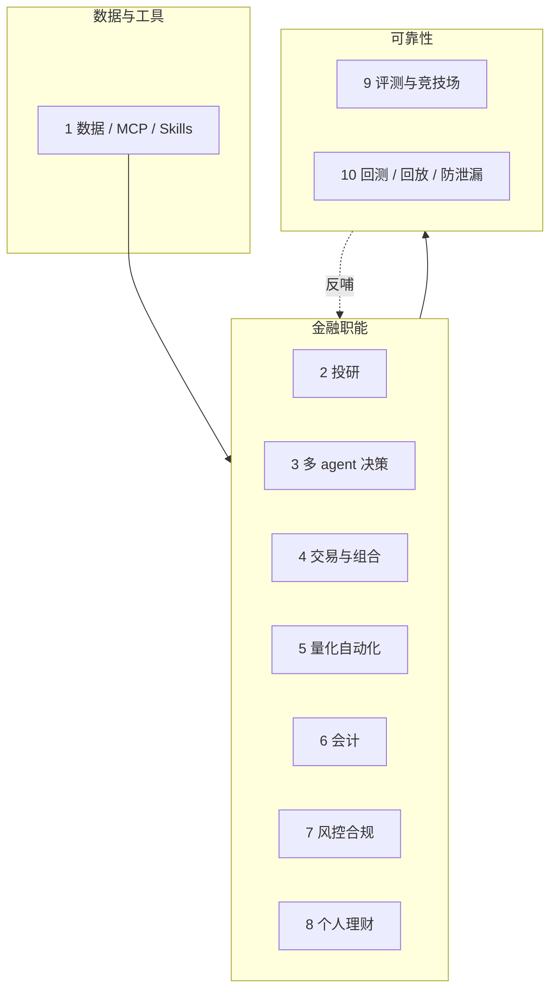

# Awesome Finance Agents 

> 按金融职能与可靠性组织的开源 LLM 金融 agent 精选：投研、交易、财务运营、风控合规、个人理财，并把评测与防泄漏回测当作一等公民章节。

[English](README.md) | **简体中文**

> **不构成投资建议。** 收录不代表背书。很多项目只是研究演示；模拟盘和实盘不是一回事。合规、风险与亏损由你自己负责。

多数金融 agent 清单只做交易。本清单按**金融职能 + 可靠性**组织。交易只占一章，深度交易目录见附录中的 LLMQuant/awesome-trading-agents。其他清单常缺的 **会计、合规、评测、防泄漏回测/回放** 是这里的差异化重点。

每章固定写：要解决的问题、开源实现、踩坑提示。正文不写星数，避免过时。🇨🇳 标记 A 股 / 中文项目。`(sim)` / `(live)` / `(paper)` 在资料明确时标注模拟盘、实盘或论文代码。

## 目录

- [全景图](#全景图)
- [怎么用这份清单](#怎么用这份清单)
- [1. 数据与工具](#1-数据与工具)
- [2. 投研与深度研究](#2-投研与深度研究)
- [3. 多 agent 投研与决策系统](#3-多-agent-投研与决策系统)
- [4. 交易执行与组合管理](#4-交易执行与组合管理)
- [5. 量化研究自动化](#5-量化研究自动化)
- [6. 财务运营与会计](#6-财务运营与会计)
- [7. 风控、合规与审计](#7-风控、合规与审计)
- [8. 个人理财](#8-个人理财)
- [9. 评测基准与竞技场](#9-评测基准与竞技场)
- [10. 回测、回放与防泄漏](#10-回测、回放与防泄漏)
- [附录](#附录)

## 全景图

| #  | 章节          | 核心问题                                   |
| -- | ------------- | ------------------------------------------ |
| 1  | 数据与工具    | agent 如何拿到可信、带时间戳的行情与财报？ |
| 2  | 投研          | 如何把财报和新闻变成可溯源备忘录？         |
| 3  | 多 agent 决策 | 专长 agent 如何辩论并交接决策？            |
| 4  | 交易与组合    | 信号如何变成带仓位与风控的订单？           |
| 5  | 量化自动化    | agent 如何挖因子并迭代策略？               |
| 6  | 会计          | 如何记账对账且不改写历史？                 |
| 7  | 风控合规      | AML/KYC、尽调与不可逆动作如何闸控？        |
| 8  | 个人理财      | 本地优先应用如何把账户暴露给 agent？       |
| 9  | 评测与竞技场  | 如何衡量研究、决策、安全与实盘能力？       |
| 10 | 回测与防泄漏  | agent 循环下如何保持市场时间正确性？       |

## 怎么用这份清单

**做投研 agent。** 从第 1 → 2 → 9 章开始。

**做交易 agent。** 读 1 → 3/4 → 10 → 9，交易深度见附录里的交易向清单。

**运营 / 合规 / 个人理财。** 第 6、7、8 章条目少，但这正是差异化所在。

**面试或设计评审。** 把每章的踩坑提示当失败模式清单。

这是精选短名单，不是大全。链接在收录时检查过；CI 会跑 awesome-lint 与每周坏链检查。

## 1. 数据与工具

### 要解决的问题

金融 agent 的上限取决于它能调用的数据和工具。本章收录行情、财报、券商桥，以及面向 MCP 的 Skills 包。

### 平台与行情数据

- [OpenBB](https://github.com/openbq-org/OpenBB) - 面向分析师、量化和 AI agent 的开放数据平台，覆盖股票、期权、加密和宏观。
- [akshare](https://github.com/akfamily/akshare) - 🇨🇳 A 股与多市场数据工具包，常被当作 agent 的数据后端。
- [a-stock-data](https://github.com/simonlin1212/a-stock-data) - 🇨🇳 面向 agent 与投研流程的高覆盖 A 股数据接口。
- [edgartools](https://github.com/dgunning/edgartools) - 类型友好的 SEC EDGAR Python API：10-K/8-K、XBRL、13F、Form 3/4/5。
- [MarS](https://github.com/microsoft/MarS) - 微软的金融市场仿真引擎，由生成式基础模型驱动。

### MCP 服务器

- [financial-services](https://github.com/anthropics/financial-services) - Anthropic 官方的金融服务 Skills 与连接器合集。
- [alpaca-mcp-server](https://github.com/alpacahq/alpaca-mcp-server) - Alpaca 官方 MCP：股票/ETF/期权/加密，支持模拟盘。(sim)
- [FinanceMCP](https://github.com/guangxiangdebizi/FinanceMCP) - 🇨🇳 面向 Claude 类 agent 的 Tushare + Binance 金融 MCP。
- [mcp-cn-a-stock](https://github.com/elsejj/mcp-cn-a-stock) - 🇨🇳 向大模型提供 A 股行情数据的 MCP 服务。
- [sec-edgar-mcp](https://github.com/stefanoamorelli/sec-edgar-mcp) - 用于浏览和查询 SEC EDGAR 文件的 MCP 服务器。
- [yahoo-finance-mcp](https://github.com/Alex2Yang97/yahoo-finance-mcp) - 通过 MCP 暴露的 Yahoo Finance 行情数据。
- [mcp_massive](https://github.com/massive-com/mcp_massive) - Massive.com（原 Polygon）行情数据的 MCP。
- [tradingview-mcp](https://github.com/atilaahmettaner/tradingview-mcp) - TradingView MCP：行情、筛选、技术指标与回测桥接。
- [polymarket-mcp-server](https://github.com/caiovicentino/polymarket-mcp-server) - Polymarket 预测市场 MCP，带监控与安全特性。(sim/live)
- [okx/agent-trade-kit](https://github.com/okx/agent-trade-kit) - OKX 交易 MCP：现货、永续、期货、期权与网格。(live)

### Skills 包

- [finance-skills](https://github.com/himself65/finance-skills) - 面向 AI 金融分析流程的 Skills 包。
- [claude-trading-skills](https://github.com/tradermonty/claude-trading-skills) - 面向美股投资者与交易者的 Claude Skills 包。

### 踩坑提示

优先使用带时间戳、可做时点对齐的数据源。不要让模型编造行情或财报数字。凡是能下单的工具都标成有写入能力，并放在审批后面。

## 2. 投研与深度研究

### 要解决的问题

投研 agent 阅读财报、电话会、新闻和资料室，产出可溯源的投资备忘录。难点是每一条数字和结论都要有出处。

### 开源投研 agent

- [dexter](https://github.com/virattt/dexter) - 带工具调用和结构化报告的自主深度金融研究 agent。
- [FinRobot](https://github.com/AI4Finance-Foundation/FinRobot) - AI4Finance 出品的开源金融 AI agent 平台。
- [LangAlpha](https://github.com/ginlix-ai/LangAlpha) - 面向金融市场投研的 Claude Code 风格工作台。
- [FinSight](https://github.com/RUC-NLPIR/FinSight) - 深度金融研究 agent 框架（ACL 2026 相关）。
- [ai-berkshire](https://github.com/xbtlin/ai-berkshire) - 巴菲特/芒格式的价值投资多智能体投研。
- [Vibe-Research](https://github.com/simonlin1212/Vibe-Research) - 🇨🇳 A/美/港股投研工作台，本地数据面较全。
- [ai-financial-agent](https://github.com/virattt/ai-financial-agent) - 来自 dexter / ai-hedge-fund 作者的投资研究金融 agent。
- [DeepEar](https://github.com/HKUSTDial/DeepEar) - 🇨🇳 深度研究与金融信号追踪框架（顺风耳）。
- [claude-equity-research](https://github.com/quant-sentiment-ai/claude-equity-research) - 面向机构风格股票研究的 Claude Code 插件。
- [easy-stock](https://github.com/jundizhou/easy-stock) - 🇨🇳 A 股分析与 AI 投研桌面工作台。

### 踩坑提示

要求引用到具体财报章节或 URL。拒绝编造财务比率的回答。优先选择能保留工具调用轨迹、可审计的 agent。

## 3. 多 agent 投研与决策系统

### 要解决的问题

这类系统模拟分析师团队：专长 agent 辩论、交接并形成决策。更适合研究角色结构，而不是开箱即用的 alpha。

### 代表性多 agent 系统

- [TradingAgents](https://github.com/TauricResearch/TradingAgents) - 带分析师、交易员、风控角色的多智能体 LLM 交易框架。
- [ai-hedge-fund](https://github.com/virattt/ai-hedge-fund) - 由专长投资 agent 组成的 AI 对冲基金模拟。
- [TradingAgents-CN](https://github.com/hsliuping/TradingAgents-CN) - 🇨🇳 中文增强版 TradingAgents，适配本地市场。
- [valuecell](https://github.com/ValueCell-ai/valuecell) - 面向金融应用的社区多智能体平台。
- [AutoHedge](https://github.com/The-Swarm-Corporation/AutoHedge) - Swarm 风格的自动对冲多智能体系统。
- [TradingAgents-astock](https://github.com/simonlin1212/TradingAgents-astock) - 🇨🇳 适配 A 股的 TradingAgents，带本地数据特性。
- [aiagents-stock](https://github.com/oficcejo/aiagents-stock) - 🇨🇳 多 AI 股票团队：分析、盯盘与板块轮动预警。
- [TradingAgents-AShare](https://github.com/KylinMountain/TradingAgents-AShare) - 🇨🇳 A 股多智能体投研台，带辩论界面。
- [lumibot](https://github.com/Lumiwealth/lumibot) - 可连接多家券商的交易 agent，支持回测。(sim/live)
- [ai-hedge-fund-crypto](https://github.com/51bitquant/ai-hedge-fund-crypto) - 面向加密市场的 ai-hedge-fund 分支。

### 踩坑提示

辩论不等于正确。注意跨 agent 的上下文污染，以及所谓共识其实只是提示词最响的那个角色。

## 4. 交易执行与组合管理

### 要解决的问题

从信号到订单：仓位、风险预算、券商/交易所连接，以及组合分析。更完整的交易向清单见附录中的 LLMQuant/awesome-trading-agents。

### LLM 交易 agent

- [daily_stock_analysis](https://github.com/ZhuLinsen/daily_stock_analysis) - 🇨🇳 多市场 LLM 股票分析，带看板与告警。
- [Vibe-Trading](https://github.com/HKUDS/Vibe-Trading) - HKUDS 的个人交易 agent 栈。(sim)
- [AI-Trader](https://github.com/HKUDS/AI-Trader) - 面向 agent 的自动化交易研究系统。
- [nofx](https://github.com/NoFxAiOS/nofx) - 覆盖美股、商品、外汇与加密的 AI 交易终端助手。(sim/live)
- [OpenAlice](https://github.com/TraderAlice/OpenAlice) - 一人华尔街风格的多资产 AI 交易 agent。
- [AgenticTrading](https://github.com/Open-Finance-Lab/AgenticTrading) - 与评测 harness 配套的 agent 交易研究代码。
- [FinRL-Trading](https://github.com/AI4Finance-Foundation/FinRL-Trading) - AI 原生的模块化量化交易基础设施（FinRL-X）。
- [FinMem-LLM-StockTrading](https://github.com/pipiku915/FinMem-LLM-StockTrading) - FinMem 系列的分层记忆 LLM 交易 agent。(paper)

### 券商桥与执行底座

- [alpaca-py](https://github.com/alpacahq/alpaca-py) - Alpaca 官方 Python SDK，常作 agent 模拟/实盘后端。(sim/live)
- [freqtrade](https://github.com/freqtrade/freqtrade) - 常用的加密交易机器人，也常被当作 agent 执行后端。(sim/live)
- [hummingbot](https://github.com/hummingbot/hummingbot) - 开源加密做市与执行框架。(live)
- [tradememory-protocol](https://github.com/mnemox-ai/tradememory-protocol) - 面向 AI 交易 agent 的决策审计轨迹与记忆协议。

### 踩坑提示

模拟盘和实盘要分开。永远不要给 agent 无上限的实盘下单权限。在相信收益截图之前，先建模手续费、滑点和停牌规则。

## 5. 量化研究自动化

### 要解决的问题

挖掘因子、写策略代码、跑回测并迭代的 agent，最接近「自主量化研究员」。

### 研究自动化系统

- [qlib](https://github.com/microsoft/qlib) - 面向 AI 的量化平台，常作因子与模型研究 agent 的底座。
- [RD-Agent](https://github.com/microsoft/RD-Agent) - 微软 R&D agent，在金融因子/策略自动化赛道很强。
- [alphagen](https://github.com/ICT-FinD-Lab/alphagen) - 用强化学习生成公式化 alpha 因子集合。
- [QuantaAlpha](https://github.com/QuantaAlpha/QuantaAlpha) - 用 agent 工作流发现量化 alpha 因子。
- [QuantGPT](https://github.com/Miasyster/QuantGPT) - 自主设计、回测并提交因子的 agent 化 alpha 工厂。
- [AlphaFin](https://github.com/AlphaFin-proj/AlphaFin) - 检索增强的 stock-chain 风格金融分析。
- [pwb-alphaevolve](https://github.com/paperswithbacktest/pwb-alphaevolve) - 把 AlphaEvolve 风格编码 agent 用到交易策略上。
- [Alpha-R1](https://github.com/FinStep-AI/Alpha-R1) - FinStep-AI 的 alpha / 因子研究 agent 系列。

### 踩坑提示

因子工厂很容易过拟合。要求走步向前验证或 purged CV，并留一份 agent 永远看不到的 holdout。

## 6. 财务运营与会计

### 要解决的问题

记账、对账、发票审核与报表类 agent。开源仍然很稀薄，所以单独成章。

### 账本与会计 agent

- [beancount](https://github.com/beancount/beancount) - 复式明文记账账本，常被记账 agent 当作写入目标。
- [fava](https://github.com/beancount/fava) - Beancount 的 Web UI，适合作为会计 agent 旁边的人工复核界面。
- [Klaudia](https://github.com/Yudhyy/Klaudia) - 自托管的 agent 会计师：票据、对账与审批。
- [norman-mcp-server](https://github.com/norman-finance/norman-mcp-server) - 面向欧洲的 AI 记账与报税自动化 MCP。
- [Bookkeeping-Agency-Skill](https://github.com/cyhzzz/Bookkeeping-Agency-Skill) - 🇨🇳 面向中国代理记账场景的 Skills 包。

### 踩坑提示

会计 agent 必须只追加或经审批。绝不允许 agent 静默改写历史账本分录。

## 7. 风控、合规与审计

### 要解决的问题

AML/KYC、反欺诈分诊、尽调、ESG 审查，以及挡在不可逆动作（下单、支付、写账）前面的 action firewall。

### 尽调、AML/KYC 与防火墙

- [due-diligence-agents](https://github.com/zoharbabin/due-diligence-agents) - 多智能体的并购 / 企业尽调工作流。
- [cordum](https://github.com/cordum-io/cordum) - 在高风险工具调用执行前做审批的 agent action firewall。
- [tcaml-framework](https://github.com/tomcustos/tcaml-framework) - 带明确人工闸门的开源 AML/KYC/KYB agent 框架。
- [MutiAgent4Fraud](https://github.com/zheng977/MutiAgent4Fraud) - 多智能体反欺诈检测研究系统。
- [agentfactory-business-plugins](https://github.com/panaversity/agentfactory-business-plugins) - 覆盖 AML/KYC、IFRS9、Basel 等主题的银行金融 agent skills。
- [banking_plugin_qcc](https://github.com/duhu2000/banking_plugin_qcc) - 🇨🇳 银行类 agent，配合企查查 MCP 做中国尽调。
- [FinVault](https://github.com/aifinlab/FinVault) - 面向执行落地的金融 agent 安全评测。
- [ESGenius](https://github.com/ANGEL-NTU/ESGenius) - 面向 LLM 的 ESG 知识评测基准。

### 踩坑提示

合规 agent 应该提出建议，而不是自动放行。保留人工闸门，以及对每条被覆盖告警的不可篡改审计日志。

## 8. 个人理财

### 要解决的问题

预算、消费分析、净资产跟踪，以及 agent 可通过 MCP/Skills 接入的本地优先理财应用。

### 应用与 MCP 桥

- [actual](https://github.com/actualbudget/actual) - 本地优先的个人理财应用，常作为 agent 的接入面。
- [firefly-iii](https://github.com/firefly-iii/firefly-iii) - 自托管个人财务管家，API 较成熟。
- [accountant24](https://github.com/machulav/accountant24) - 围绕记账流程的个人理财 agent。
- [monarch-mcp-server](https://github.com/robcerda/monarch-mcp-server) - Monarch Money 个人财务数据的 MCP 服务器。
- [lunchmoney-mcp](https://github.com/akutishevsky/lunchmoney-mcp) - Lunch Money 个人理财 MCP。
- [moneymatter](https://github.com/letehaha/moneymatter) - 自托管预算工具，内置 MCP 服务器。
- [mcp-server-firefly-iii](https://github.com/fabianonetto/mcp-server-firefly-iii) - 把 agent 接到 Firefly III 的 MCP 服务器。
- [finance-assistant](https://github.com/googlarz/finance-assistant) - 个人理财副驾 skill（FIRE 规划、银行流水格式等）。
- [opencoffer](https://github.com/osirishorus/opencoffer) - 自托管个人理财，支持自备 LLM 聊天与 MCP。

### 踩坑提示

优先本地优先或只读 MCP 访问银行数据。绝不要把原始银行凭证写进 agent 提示词或聊天日志。

## 9. 评测基准与竞技场

### 要解决的问题

衡量研究问答、交易决策、安全性和实盘竞技场表现。没有评测，金融 agent 就只是演示。

### 研究与开卷问答

- [PIXIU](https://github.com/The-FinAI/PIXIU) - FinMA + FinBen 金融 LLM 评测套件。
- [FinBen](https://github.com/The-FinAI/FinBen) - The-FinAI 的综合性金融 LLM 基准。
- [financebench](https://github.com/patronus-ai/financebench) - 基于真实财报的开卷金融问答基准。
- [finance-agent](https://github.com/vals-ai/finance-agent) - 带工具调用的金融研究 agent 基准（arXiv:2508.00828）。
- [finance-agent-v2](https://github.com/vals-ai/finance-agent-v2) - Finance Agent 基准 v2，含 EDGAR、网页与价格工具。
- [FinSearchComp](https://github.com/randomtutu/FinSearchComp) - 专家级金融搜索与推理基准（字节 Seed 相关）。
- [BizFinBench](https://github.com/HiThink-Research/BizFinBench) - 面向真实业务场景的金融 LLM 基准。
- [FinEval](https://github.com/SUFE-AIFLM-Lab/FinEval) - 🇨🇳 中文金融 LLM 评测套件。
- [MME-Finance](https://github.com/HiThink-Research/MME-Finance) - 面向专家级理解的多模态金融基准。

### 决策、交易与竞技场

- [INVESTOR-BENCH](https://github.com/felis33/INVESTOR-BENCH) - InvestorBench：LLM agent 金融决策基准（ACL 2025）。
- [QuantitativeFinance-Bench](https://github.com/QF-Bench/QuantitativeFinance-Bench) - 在 Harbor 上的状态感知交互式量化 agent 基准。
- [stockbench](https://github.com/ChenYXxxx/stockbench) - 受控环境下检验 LLM agent 能否交易盈利的基准。
- [live-trade-bench](https://github.com/ulab-uiuc/live-trade-bench) - 交易 agent 的实盘/在线评测。
- [Agent_Market_Arena](https://github.com/The-FinAI/Agent_Market_Arena) - 面向 LLM agent 的多市场实盘竞技场。
- [alpha-arena](https://github.com/AmadeusGB/alpha-arena) - 交易 agent 的 Alpha 竞技场竞赛 harness。
- [DeepFund](https://github.com/HKUSTDial/DeepFund) - NeurIPS'25 基金投资风格的 agent 评测试点。
- [QuantCode-Bench](https://github.com/LimexAILab/QuantCode-Bench) - 可执行算法交易代码生成基准。
- [TwinMarket](https://github.com/FreedomIntelligence/TwinMarket) - 用于研究 agent 交互的 LLM 驱动市场仿真。

### 安全与可信

- [awesome-financial-llm-trustworthiness-benchmarks](https://github.com/FDU-INS/awesome-financial-llm-trustworthiness-benchmarks) - 金融 LLM 可信度相关基准的精选清单。

### 踩坑提示

没有成本、延迟和防泄漏控制的排行榜收益不能当证据。优先选择公开污染策略和工具访问规则的基准。

## 10. 回测、回放与防泄漏

### 要解决的问题

金融专属可靠性层：时点数据、前视偏差控制、确定性回放和真实成本模型。通用 agent 持久执行放在 agent-infra 类清单；本章只谈市场时间正确性。

### Harness 与引擎

- [TraderHarness](https://github.com/HephaestLab/TraderHarness) - ⭐ 面向 LLM 交易者的抗污染时点回测与回放 harness。
- [nautilus_trader](https://github.com/nautechsystems/nautilus_trader) - 确定性生产级交易引擎，可作 agent 执行底座。
- [vectorbt](https://github.com/polakowo/vectorbt) - 高性能向量化回测，常被策略 agent 封装调用。
- [backtesting.py](https://github.com/kernc/backtesting.py) - 简洁易读的 Python 回测库，适合策略原型。
- [pybroker](https://github.com/edtechre/pybroker) - 带机器学习友好回测钩子的 Python 算法交易库。
- [zipline-reloaded](https://github.com/stefan-jansen/zipline-reloaded) - 持续维护的 Zipline 分支，做 Python 事件驱动回测。

### 踩坑提示

如果回测能看到明天的收盘价，agent 就是在作弊。优先使用时点数据集、隔离分割，以及钉住模型与数据版本的回放日志。

## 附录

模型、综述和相邻清单：有用的上下文，但本身不都是 agent。

### 金融大模型与相关模型

- [FinGPT](https://github.com/AI4Finance-Foundation/FinGPT) - AI4Finance 的开源金融大模型系列。
- [FinRL](https://github.com/AI4Finance-Foundation/FinRL) - 金融强化学习库与教程。
- [Fin-R1](https://github.com/SUFE-AIFLM-Lab/Fin-R1) - 🇨🇳 金融推理大模型 Fin-R1。
- [Kronos](https://github.com/shiyu-coder/Kronos) - 面向金融市场的基础模型。
- [finBERT](https://github.com/ProsusAI/finBERT) - 经典的金融情感分析 BERT。
- [XuanYuan](https://github.com/Duxiaoman-DI/XuanYuan) - 🇨🇳 中文金融大模型「轩辕」。

### 综述与论文清单

- [Agentic_FinTech_Survey](https://github.com/agentic-fintech/Agentic_FinTech_Survey) - 金融 / 金融科技中的 AI agent 综述。
- [fin_survey](https://github.com/F1y1113/fin_survey) - EMNLP 2025：金融领域 LLM agent 综述材料。
- [Awesome-LLM-Quantitative-Trading-Papers](https://github.com/Tom-roujiang/Awesome-LLM-Quantitative-Trading-Papers) - LLM 量化交易、基准与竞技场相关论文清单。

### 相关 awesome 清单

- [awesome-trading-agents](https://github.com/LLMQuant/awesome-trading-agents) - 交易向 agents / MCP / skills 清单（与本仓库互补）。
- [awesome-ai-in-finance](https://github.com/georgezouq/awesome-ai-in-finance) - 长期维护的 AI × 金融清单（经典量化/ML + 较新的 agent 层）。
- [awesome-finance-mcp](https://github.com/BlockRunAI/awesome-finance-mcp) - 按资产类别整理的金融 MCP 与 Skills 目录。
- [Awesome_AI4Finance](https://github.com/AI4Finance-Foundation/Awesome_AI4Finance) - AI4Finance 生态 awesome 清单。
- [awesome-quant](https://github.com/wilsonfreitas/awesome-quant) - 经典量化金融库与资源清单。
- [thuquant/awesome-quant](https://github.com/thuquant/awesome-quant) - 🇨🇳 中文 awesome-quant。
- [awesome-systematic-trading](https://github.com/paperswithbacktest/awesome-systematic-trading) - 系统化交易论文与代码。
- [Awesome-Prediction-Market-Tools](https://github.com/aarora4/Awesome-Prediction-Market-Tools) - 预测市场工具与基础设施。
- [Introduction-to-Quantitative-Finance](https://github.com/Barca0412/Introduction-to-Quantitative-Finance) - 🇨🇳 中文量化入门，带 AI+金融 arXiv Radar。

## 贡献

欢迎贡献。请先阅读 [贡献指南](CONTRIBUTING.md)。变更记录见 [changelog](CHANGELOG.md)。

## 备注

不构成投资建议。收录不代表对任何交易策略、产品或模型的背书。

以 [CC0 1.0 Universal](LICENSE) 发布。
